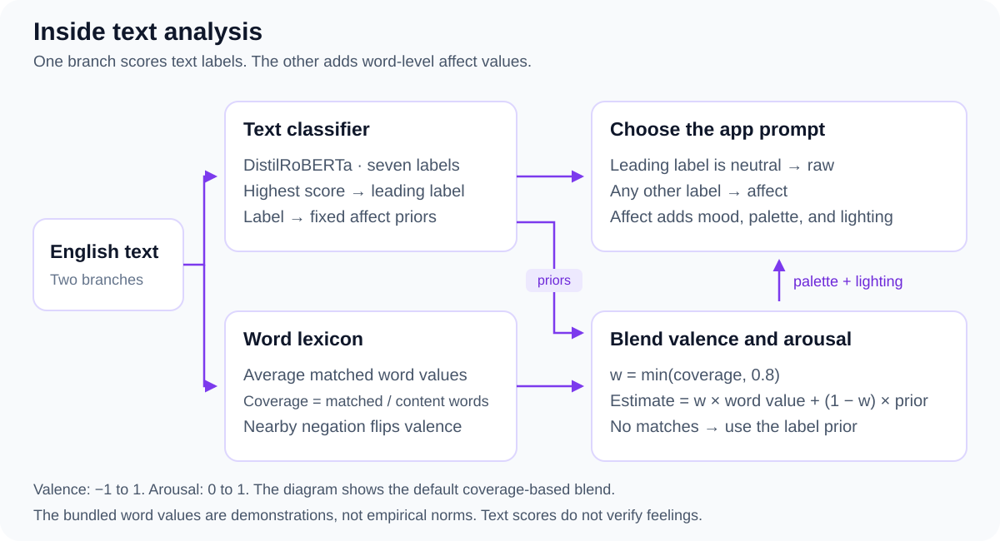

# NovaVision

Generate images from English text and emotion labels. Compare intended and recovered emotion in separate research experiments.

[Interface preview](https://urmeo.github.io/nova-vision/) · [Run locally](#run) · [Method and data](docs/method.md) · [Notebook](notebooks/reproduce.ipynb)

<p align="center">
  
</p>

Recorded demo from an earlier interface. The current interface text differs. The animation illustrates the workflow; it is not an evaluation result.

**Python · PyTorch · Transformers · Diffusers · NumPy · Pillow · Flask**

## Pipeline


The app scores seven emotion labels and blends word values with label priors to estimate valence and arousal. The leading label selects the prompt: neutral uses `raw`; other labels use `affect`, which adds mood, palette, and lighting cues. Every tier retains style and fixed quality terms.

Experiments compare `raw`, `naive`, `emotion`, and `affect` with the same seed for each input and intended label. An independent image probe supplies predictions for recovery and affect metrics. The app does not use those predictions to revise its images.

<details>
<summary>How text analysis and affect estimates work</summary>



The default lexicon weight is `min(coverage, 0.8)`. With no matched words, the estimate comes from the leading label's prior. Text scores do not verify a person's feelings. The bundled lexicon contains demonstration values, not empirical norms.

[Pipeline details, controls, and code](docs/method.md)

</details>

## Interface

| Current local interface | Earlier text-analysis example |
|:---:|:---:|
|  |  |

The screenshots show interface states, not benchmark measurements. The [public preview](https://urmeo.github.io/nova-vision/) displays the interface and saved charts. Analysis and generation require the Flask server below.

## Results

**Saved pilot: SD-Turbo · CLIP ViT-B/32 · CPU · 256 × 256 images · two neutral subjects · one seed**

| Condition | Images | Recovery | Bootstrap 95% CI | Shuffled-label p |
|---|---:|---:|---:|---:|
| `raw` | 14 | 14.29% | 0–35.71% | .8566 |
| `emotion` | 14 | 21.43% | 0–42.86% | .2259 |
| `affect` | 14 | 21.43% | 0–42.86% | .1369 |
| `scene` | 7 | 28.57% | 0–57.50% | .1449 |

**Chance agreement: 14.29% (1/7). The pilot does not establish emotion controllability.** No saved condition exceeds the shuffled-label control at p < .05. Neither conditioning tier is significant after Holm correction. The scene diagnostic uses fixed emotion scenes and is separate from the paired tiers; `naive` is unmeasured.

| Recovery and 95% confidence intervals | Raw-tier confusion |
|:---:|:---:|
|  |  |

| Emotion-tier confusion | Affect-tier confusion |
|:---:|:---:|
|  |  |

| Separate scene diagnostic | Affect-tier valence and arousal |
|:---:|:---:|
|  |  |

The matrices show row-normalized predictions. Across the three conditioning tiers, the probe uses only two of seven labels and predicts neutral for 90.5% of images. The affect plot compares intended prior values with image-probe estimates; it does not measure human ratings.

### Probe checks


| Probe | Faces, n=200 | Scenes, n=400 |
|---|---:|---:|
| CLIP ViT-B/32 | 29.00% | 40.25% |
| CLIP ViT-L/14 | 37.50% | 45.50% |

These checks use the training splits of `FastJobs/Visual_Emotional_Analysis` and `xodhks/EmoSet118K`, with seed 0. The scene sample has no neutral examples. Transfer of these accuracies to generated images is unmeasured. Original image IDs and dataset revisions are missing, so paired comparisons depend on the saved ordering.

The recovery correction covers five of seven classes: 10.0% apparent recovery becomes 16.5% corrected recovery within that subset. A seven-class correction and its uncertainty are unavailable.

### Planning curve


This is a saved planning simulation. It assumes independent binomial trials and transfer of real-image probe accuracy to generated images. It does not estimate power for the paired benchmark. A 420-images-per-tier run and a study with at least three independent human raters remain future work.

[Full results and limitations](docs/results.md) · [Metric tables](docs/results-tables.md) · [Saved records](outputs/results/results.json) · [Original figures](outputs/figures/)

Historical source commits, complete model pins, and original generated images are missing. Exact image replay is unverified. New runs write to `outputs/generated/`.

## Run

Python 3.9 or newer; CI checks 3.9–3.12.

```bash
git clone https://github.com/urmeo/nova-vision.git
cd nova-vision
python -m venv .venv
source .venv/bin/activate
python -m pip install -e ".[app,ml]"
NOVA_BACKEND=diffusers python server.py
```

Open [http://127.0.0.1:8000](http://127.0.0.1:8000). Models download on first use. CPU generation can be slow. The default backend, `null`, creates synthetic test images; text analysis still needs its classifier. Hosted generation uses `NOVA_BACKEND=hf-api` and `HF_TOKEN` and sends prompts to the provider. Model and dataset terms apply separately from the code license.

Check the code and regenerate the charts without model downloads:

```bash
python -m pip install -e ".[dev,research]"
python -m pytest
python scripts/visualize.py
```

## Repository

| Path | Contents |
|---|---|
| `novavision/` | Text analysis, prompts, image generation, probes, and experiments |
| `static/` | Web interface served by `server.py` |
| `scripts/` | Research commands, charts, and static preview build |
| `notebooks/` | Saved-result checks and optional model runs |
| `docs/` | Method, results, visual assets, and submission schema |
| `tests/` | Regression tests and synthetic fixtures |
| `outputs/` | Saved records, original figures, and new runs |

[Development](CONTRIBUTING.md) · [Folder guide](docs/structure.md) · [Method and data](docs/method.md)

Sole contributor: [urmeo](https://github.com/urmeo). Project code: [MIT](LICENSE).
