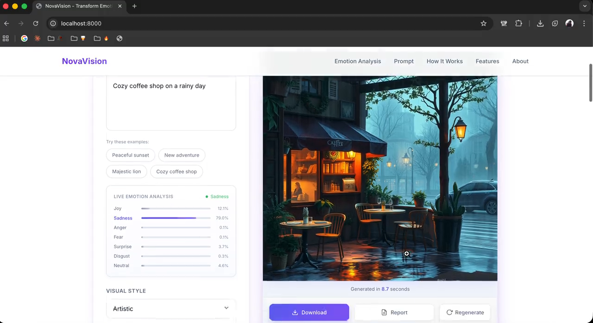

# NovaVision

A Python prototype for turning English text into image prompts with emotion, palette, and lighting cues. Separate experiments test whether an image probe recovers the intended emotion.

[](docs/assets/pipeline.svg)

Text analysis shapes the generation prompt. Separate experiments compare prompt tiers with fixed targets and shared seeds; probe predictions do not feed back into generation.

[Edit pipeline in Figma](https://www.figma.com/design/6lh7NsSYszXlyDrk6I1IaU?node-id=14-2) · [Figure sources and captions](docs/pipeline-figures.md)

[Interface preview](https://urmeo.github.io/nova-vision/) · [Videos](#videos) · [Run locally](#run) · [Method and data](docs/method.md) · [Notebook](notebooks/reproduce.ipynb)

**Python · PyTorch · Transformers · Diffusers · NumPy · Pillow · Flask**

The [public website](https://urmeo.github.io/nova-vision/) is a static preview. Run the Python server for text analysis and image generation.

## Videos

| Current interface and pipeline · 0:28 | Earlier generation demo · 2:05 |
|:---:|:---:|
| <a href="https://urmeo.github.io/nova-vision/assets/videos.html#pipeline-tour"></a> | <a href="https://urmeo.github.io/nova-vision/assets/videos.html#recorded-demo"></a> |
| [Watch tour](https://urmeo.github.io/nova-vision/assets/videos.html#pipeline-tour) · [MP4 file](docs/assets/pipeline-tour.mp4) | [Watch full recording](https://urmeo.github.io/nova-vision/assets/videos.html#recorded-demo) · [MP4 file](docs/assets/demo.mp4) |

The current tour shows the preview, pipeline, and saved charts. The earlier recording uses an older interface; its model and run settings are unavailable. Both videos are silent and have text descriptions. Neither is a benchmark result.

<details>
<summary>10-second excerpt from the earlier recording</summary>

<p align="center">
  <a href="https://urmeo.github.io/nova-vision/assets/videos.html#recorded-demo"></a>
</p>

</details>

<details>
<summary>Pipeline details</summary>

[](docs/assets/analysis.svg)

The app scores seven emotion labels. It blends matched word values with priors for the leading label to estimate valence (pleasantness) and arousal (activation). The default word weight is `min(coverage, 0.8)`; no matches means the estimate comes from the label prior. The bundled word values are demonstrations, not empirical norms. Text scores do not verify a person's feelings.

Neutral uses `raw`; other leading labels use `affect`, adding mood, palette, lighting, and composition cues. Both retain the original text, selected style, and fixed quality terms.

Experiments compare `raw`, `naive`, `emotion`, and `affect` with the same seed for each input, intended label, and seed index. An image probe supplies emotion and affect estimates for comparison with known targets. The saved pilot has no `naive` measurement or human ratings.

[Pipeline details, controls, and code](docs/method.md)

</details>

## Run

Use Python 3.9 or newer. CI checks Python 3.9–3.12.

```bash
git clone https://github.com/urmeo/nova-vision.git
cd nova-vision
python -m venv .venv
source .venv/bin/activate
python -m pip install -e ".[app,ml]"
NOVA_BACKEND=diffusers python server.py
```

On Windows, activate the environment with `.venv\Scripts\Activate.ps1` in PowerShell, then set `$env:NOVA_BACKEND = "diffusers"` before running `python server.py`.

Open [http://127.0.0.1:8000](http://127.0.0.1:8000). The first analysis and generation requests download their models. Local generation selects CUDA, Apple MPS, or CPU when available; CPU generation can be slow.

| Backend | What it does |
|---|---|
| `diffusers` | Generates images locally with PyTorch and SD-Turbo. |
| `null` — default when unset | Creates deterministic synthetic test images. Text analysis still loads its classifier. |
| `hf-api` | Sends generation prompts to Hugging Face. Requires `HF_TOKEN` and access to a supported model. |

Model and dataset terms apply separately from the code license. See [development and deployment](CONTRIBUTING.md) for request limits, tokens, and research commands.

Check the code and rebuild the saved charts without model downloads. Browser-script tests use Node 22 in CI.

```bash
python -m pip install -e ".[dev]"
python -m pytest
node --test tests/test_web_ui.js
python scripts/visualize.py
```

## Interface

| Current local interface | Earlier text-analysis example |
|:---:|:---:|
| <a href="docs/assets/interface.png"></a> | <a href="outputs/figures/emotion_analysis.png"></a> |

These screenshots show interface states, not benchmark measurements. The gallery includes archived examples alongside the current local interface.

| Earlier prompt details | Earlier displayed image |
|:---:|:---:|
| <a href="docs/assets/prompt-example.png"></a> | <a href="docs/assets/generation-example.png"></a> |

These archived examples use older prompt wording. Their original model and run settings are unavailable. Open any gallery image to inspect it at full size.

## Results

**Saved pilot: SD-Turbo · CLIP ViT-B/32 · CPU · 256 × 256 images · two neutral subjects · one seed**

| Condition | Images | Recovery | Bootstrap 95% CI | Shuffled-label p |
|---|---:|---:|---:|---:|
| `raw` | 14 | 14.29% | 0–35.71% | .8566 |
| `emotion` | 14 | 21.43% | 0–42.86% | .2259 |
| `affect` | 14 | 21.43% | 0–42.86% | .1369 |
| `scene` | 7 | 28.57% | 0–57.50% | .1449 |

**Chance agreement: 14.29% (1/7). The pilot does not establish emotion controllability.** No saved condition exceeds the shuffled-label control at p < .05. Neither conditioning tier is significant after Holm correction. The scene diagnostic uses fixed emotion scenes and is separate from the paired tiers; `naive` is unmeasured.

| Recovery and 95% confidence intervals | Raw-tier confusion |
|:---:|:---:|
| <a href="docs/assets/results/recovery.png"></a> | <a href="outputs/figures/confusion_raw.png"></a> |

| Emotion-tier confusion | Affect-tier confusion |
|:---:|:---:|
| <a href="outputs/figures/confusion_emotion.png"></a> | <a href="outputs/figures/confusion_affect.png"></a> |

| Separate scene diagnostic | Affect-tier valence and arousal |
|:---:|:---:|
| <a href="outputs/figures/confusion_scene.png"></a> | <a href="outputs/figures/va_affect.png"></a> |

The matrices show row-normalized predictions. Across the three conditioning tiers, the probe uses only two of seven labels and predicts neutral for 90.5% of images. The affect plot compares intended prior values with image-probe estimates; it does not measure human ratings.

### Probe checks

[](docs/assets/results/probe-comparison.png)

| Probe | Faces, n=200 | Scenes, n=400 |
|---|---:|---:|
| CLIP ViT-B/32 | 29.00% | 40.25% |
| CLIP ViT-L/14 | 37.50% | 45.50% |

These checks use the training splits of `FastJobs/Visual_Emotional_Analysis` and `xodhks/EmoSet118K`, with seed 0. The scene sample has no neutral examples. Transfer of these accuracies to generated images is unmeasured. Original image IDs and dataset revisions are missing, so historical paired comparisons are unverified. New probe comparisons require matching decoded-image fingerprints.

The recovery correction covers five of seven classes: 10.0% apparent recovery becomes 16.5% corrected recovery within that subset. A seven-class correction and its uncertainty are unavailable.

### Planning curve

[](docs/assets/results/planning-curve.png)

This is a saved planning simulation. It assumes independent binomial trials and transfer of real-image probe accuracy to generated images. It does not estimate power for the paired benchmark. A 420-images-per-tier run and a study with at least three independent human raters remain future work.

[Full results and limitations](docs/results.md) · [Metric tables](docs/results-tables.md) · [Saved records](outputs/results/results.json) · [Original figures](outputs/figures/)

Historical source commits, complete model pins, and original generated images are missing. Exact image replay is unverified. New runs write to `outputs/generated/`.

## Repository

| Path | Contents |
|---|---|
| `novavision/` | Text analysis, prompts, image generation, probes, and experiments |
| `static/` | Web interface served by `server.py` |
| `scripts/` | Research commands, charts, and static preview build |
| `notebooks/` | Saved-result checks and optional model runs |
| `docs/` | Method, results, visual assets, and submission schema |
| `tests/` | Regression tests and synthetic fixtures |
| `outputs/` | Saved records, original figures, and new runs |

[Development](CONTRIBUTING.md) · [Folder guide](docs/structure.md) · [Method and data](docs/method.md)

Sole contributor: [urme](https://github.com/urmeo). Project code: [MIT](LICENSE).
