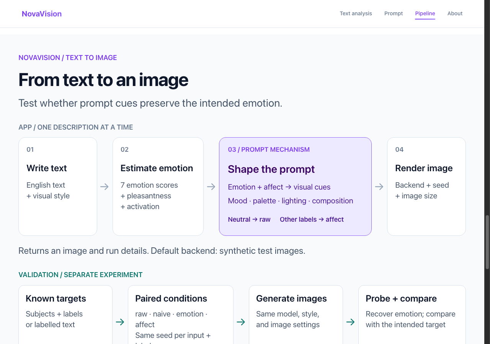
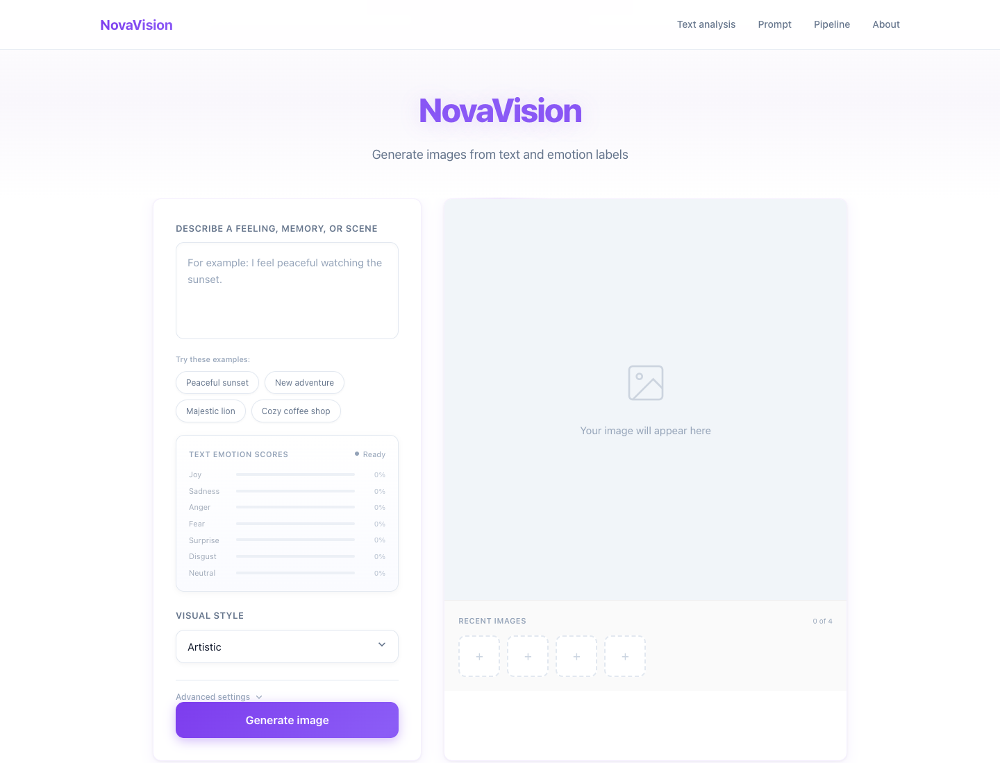
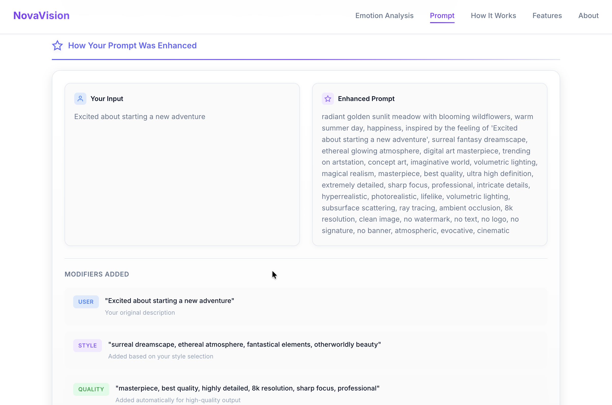
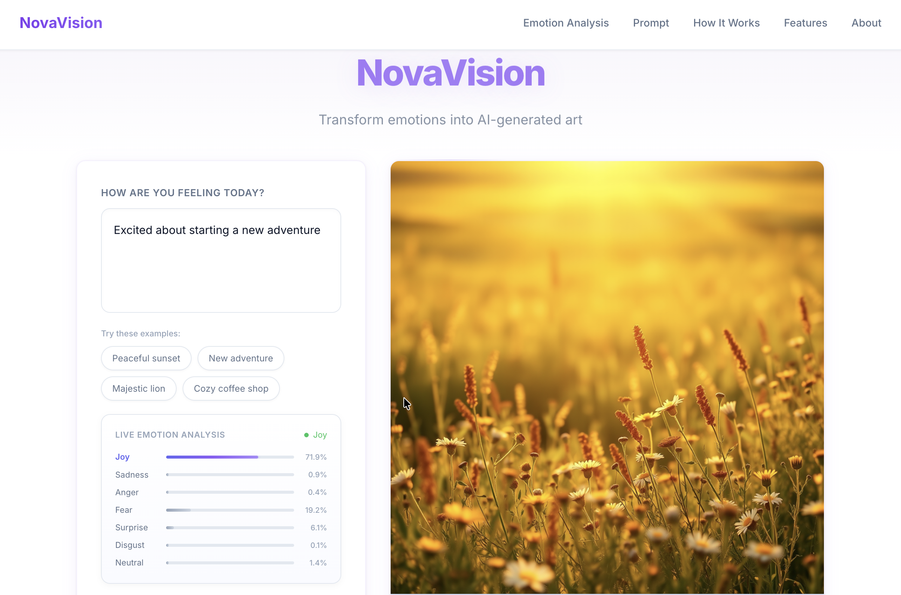
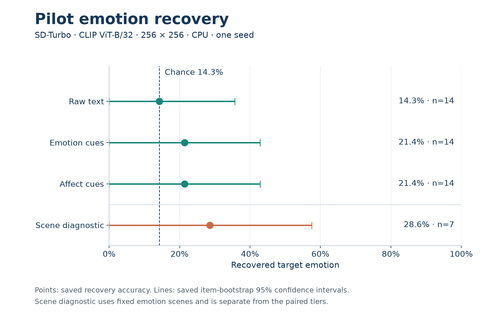
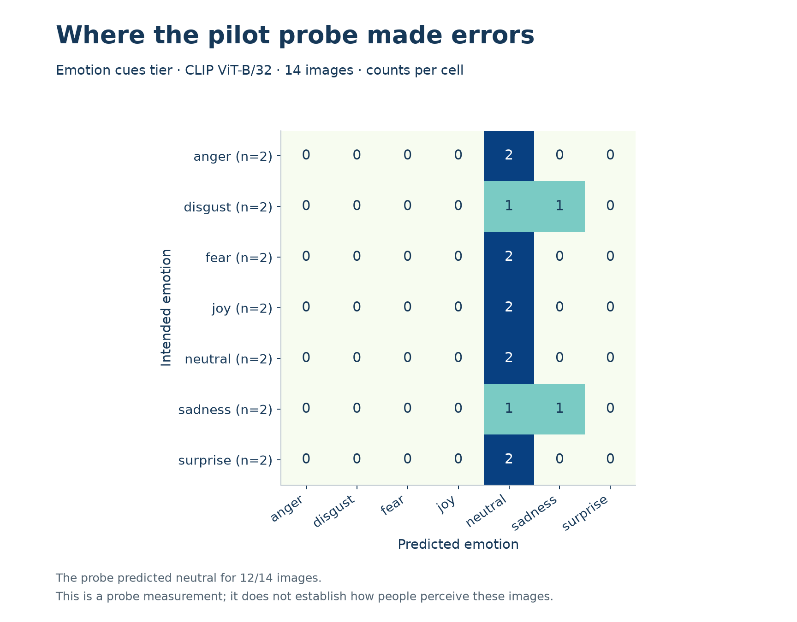
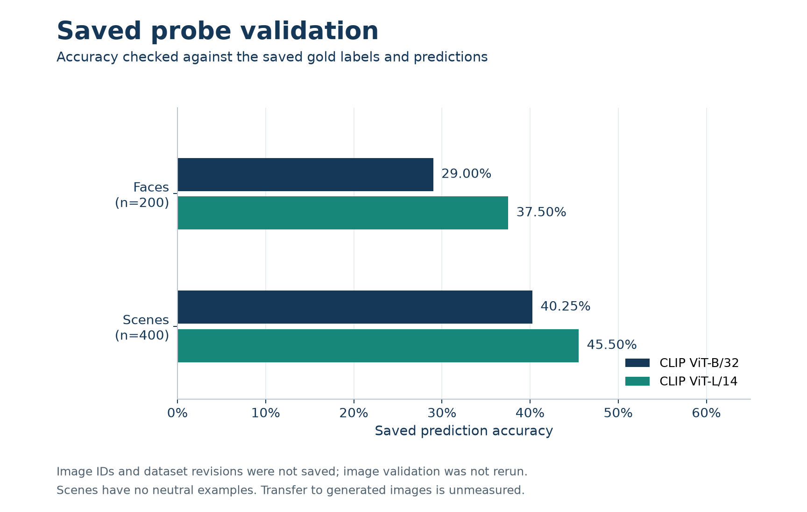
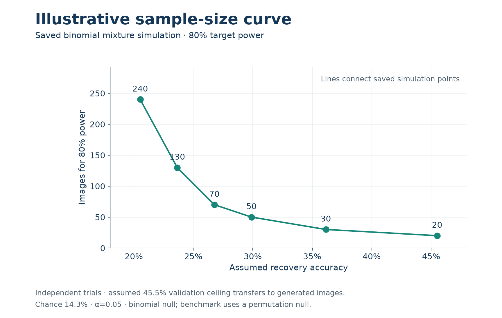

# NovaVision

A Python prototype for turning English text into image prompts with emotion, palette, and lighting cues. Separate experiments test whether an image probe recovers the intended emotion.

[](docs/assets/pipeline.svg)

[Editable Figma source](https://www.figma.com/design/6lh7NsSYszXlyDrk6I1IaU?node-id=20-2) · [Figure sources and captions](docs/pipeline-figures.md).

[https://urmeo.github.io/nova-vision/](https://urmeo.github.io/nova-vision/) · [Video](#video) · [Run locally](#run) · [Notebook](notebooks/reproduce.ipynb)

Keywords: **Python · PyTorch · Transformers · Diffusers · NumPy · Pillow · Flask**

The [public website](https://urmeo.github.io/nova-vision/) is a static preview. Run the Python server for text analysis and image generation.

## Video

**Interface and pipeline · 0:28**

<a href="https://urmeo.github.io/nova-vision/assets/videos.html#pipeline-tour"></a>

[Watch video](https://urmeo.github.io/nova-vision/assets/videos.html#pipeline-tour) · [Download MP4](docs/assets/pipeline-tour.mp4)

## Run

```bash
git clone https://github.com/urmeo/nova-vision.git
cd nova-vision
python -m venv .venv
source .venv/bin/activate
python -m pip install -e ".[app,ml]"
python -m pip install -e ".[dev]"
python -m pytest
node --test tests/test_web_ui.js
python scripts/visualize.py
NOVA_BACKEND=diffusers python server.py
```

[http://127.0.0.1:8000](http://127.0.0.1:8000).

On Windows, activate the environment with `.venv\Scripts\Activate.ps1` in PowerShell, then set `$env:NOVA_BACKEND = "diffusers"` before running `python server.py`.

## Interface

| Current local interface | Earlier text-analysis example |
|:---:|:---:|
| <a href="docs/assets/interface.png"></a> | <a href="outputs/figures/emotion_analysis.png"></a> |

| Earlier prompt details | Earlier displayed image |
|:---:|:---:|
| <a href="docs/assets/prompt-example.png"></a> | <a href="docs/assets/generation-example.png"></a> |

## Results

| Recovery and 95% confidence intervals | Raw-tier confusion |
|:---:|:---:|
| <a href="docs/assets/results/recovery.png"></a> | <a href="outputs/figures/confusion_raw.png"></a> |

| Emotion-tier confusion | Affect-tier confusion |
|:---:|:---:|
| <a href="outputs/figures/confusion_emotion.png"></a> | <a href="outputs/figures/confusion_affect.png"></a> |

[](docs/assets/results/confusion.png)

| Separate scene diagnostic | Affect-tier valence and arousal |
|:---:|:---:|
| <a href="outputs/figures/confusion_scene.png"></a> | <a href="outputs/figures/va_affect.png"></a> |

### Probe checks

[](docs/assets/results/probe-comparison.png)

### Planning curve

[](docs/assets/results/planning-curve.png)

Sole contributor: [urme](https://github.com/urmeo). Project code: [MIT](LICENSE).
