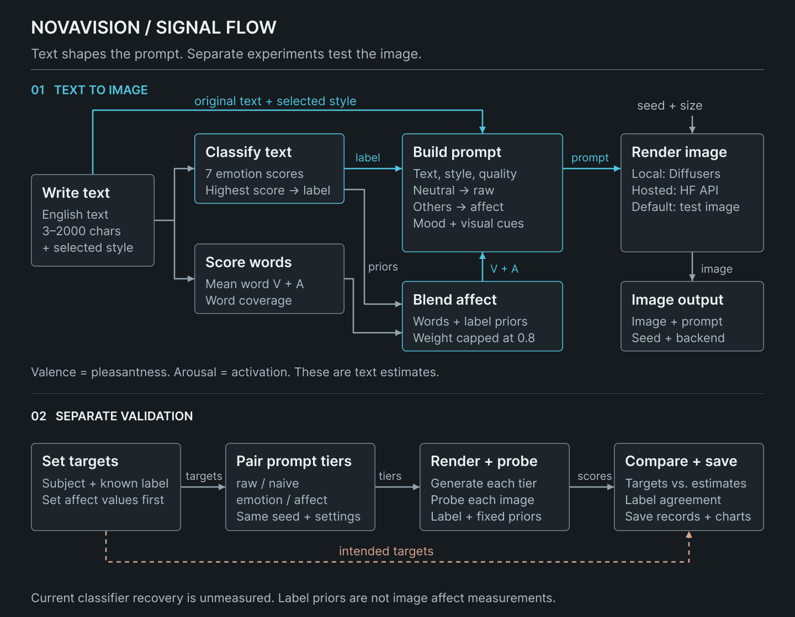

# NovaVision

NovaVision builds image prompts from English text by adding mood, color, and lighting cues. The Python prototype pairs a local generation app with experiments that test whether an image model recovers the intended emotion.

**Keywords:** Python · PyTorch · Transformers · Diffusers

## Pipeline

<a href="figma/pipeline-preview.svg"><picture><source media="(max-width: 900px)" srcset="figma/pipeline-mobile.svg"></picture></a>

[Full-size diagram](figma/pipeline.svg) · [Edit in Figma](https://www.figma.com/design/6lh7NsSYszXlyDrk6I1IaU?node-id=14-2)

## What the app does

Write an English description, choose a visual style, and set a seed. The app returns an image, the final prompt, seven emotion scores, and estimates of valence and arousal. You can inspect the prompt, download the output, and compare up to four images in the session history.

| Stage | What happens |
|---|---|
| Analyze text | A pretrained Transformers classifier scores anger, disgust, fear, joy, neutral, sadness, and surprise. |
| Estimate affect | Word scores blend with fixed emotion priors to estimate pleasantness (valence) and intensity (arousal). |
| Build the prompt | Keep the description and style. Add mood wording, a color palette, and lighting cues. Neutral text skips these extra cues. |
| Render the image | Pass the prompt, seed, and image size to the selected generation backend. Local diffusion uses SD-Turbo. |

The bundled word scores are demonstration values. The resulting affect estimates are heuristics and need validation.

### Walkthrough

[Watch the website walkthrough · 1:54](https://urmeo.github.io/nova-vision/assets/videos.html#demo) · [Download MP4](docs/assets/demo.mp4)

## How the experiments work

Experiments assign known emotion targets to neutral descriptions or use labeled text. Each comparison keeps the description, style, image size, and seed fixed across four prompt tiers. This lets it compare the effect of the added cues.

| Tier | Prompt content |
|---|---|
| `raw` | Original description, style, and shared quality wording. |
| `naive` | Add the emotion label. |
| `emotion` | Use mood phrases for the emotion. |
| `affect` | Add palette and lighting cues to the mood phrases. |

A separate image classifier assigns an emotion to each generated image. Reports compare that label with the target using accuracy, macro-F1, confusion matrices, and paired tests. Human ratings are still needed to assess how people perceive the images.

The fixed-scene diagnostic and mismatched-label control are separate from the four tiers. New local Diffusers runs record settings, input and image fingerprints, and resolved model revisions.

## Results

The current image-classifier evaluation has not been run. No measured recovery accuracy, macro-F1, or human-rating results are reported.

A new evaluation needs an image-classification checkpoint whose labels map to the project's emotion classes. Supply it with `--probe-model`, pin it with `--probe-revision`, and validate it on labeled images before running generation experiments.

The classifier's valence and arousal values come from fixed emotion-label priors. They are not independent measurements of an image's affect. Image–text similarity is unavailable in the current evaluator.

## Run

Use Python 3.11 or later. On Apple silicon, PyTorch requires macOS 14 or later. Use Node.js 22 or later for the browser checks.

The command below selects local SD-Turbo generation. The default `null` backend produces test images for development.

```bash
git clone https://github.com/urmeo/nova-vision.git
cd nova-vision
python -m venv .venv
source .venv/bin/activate
python -m pip install --upgrade -r requirements.txt
python -m pip install "pytest>=8.0" "ruff>=0.5" "matplotlib>=3.7" "datasets>=2.18"
python -m pytest
node --test tests/test_web_ui.js
NOVA_BACKEND=diffusers python -m novavision.web
```

## Repository structure

| Path | Purpose |
|---|---|
| `novavision/` | Text analysis, prompts, generation, experiments, evaluation, and the Flask server. |
| `docs/` | Web interface and the walkthrough with captions. |
| `figma/` | Pipeline diagram exports. |
| `scripts/` | Commands for evaluation reports, data setup, and site exports. |
| `tests/` | Pipeline, API, interface, and evaluation checks. |
| `outputs/generated/` | New local runs and reports; ignored by Git. |

## Roadmap

- Run all four prompt tiers with more text descriptions and seeds.
- Validate emotion probes on generated images across all seven labels.
- Collect blinded human ratings of emotion, valence, and arousal.
- Publish images, CSV results, and charts with dataset and model revisions.

## Tech Stack

| Area | Tools |
|---|---|
| Language | Python 3.11+ |
| Model inference | PyTorch · Transformers |
| Image generation | Diffusers · Hugging Face Hub |
| Arrays and images | NumPy · Pillow |
| Web interface | Flask · HTML · CSS · JavaScript |
| Research | Matplotlib · Hugging Face Datasets |

## References

- Demszky, D., Movshovitz-Attias, D., Ko, J., Cowen, A., Nemade, G., & Ravi, S. (2020). [GoEmotions: A dataset of fine-grained emotions](https://doi.org/10.18653/v1/2020.acl-main.372). In D. Jurafsky, J. Chai, N. Schluter, & J. Tetreault (Eds.), *Proceedings of the 58th Annual Meeting of the Association for Computational Linguistics* (pp. 4040–4054). Association for Computational Linguistics.
- Wolf, T., et al. (2020). [Transformers: State-of-the-art natural language processing](https://aclanthology.org/2020.emnlp-demos.6/). *Proceedings of EMNLP: System Demonstrations*, 38–45.
- Sauer, A., Lorenz, D., Blattmann, A., & Rombach, R. (2025). [Adversarial diffusion distillation](https://doi.org/10.1007/978-3-031-73016-0_6). In A. Leonardis, E. Ricci, S. Roth, O. Russakovsky, T. Sattler, & G. Varol (Eds.), *Computer vision – ECCV 2024* (Vol. 15144, pp. 87–103). Springer Nature Switzerland.
- Warriner, A. B., Kuperman, V., & Brysbaert, M. (2013). [Norms of valence, arousal, and dominance for 13,915 English lemmas](https://doi.org/10.3758/s13428-012-0314-x). *Behavior Research Methods, 45*(4), 1191–1207.

## License

[MIT](LICENSE)
