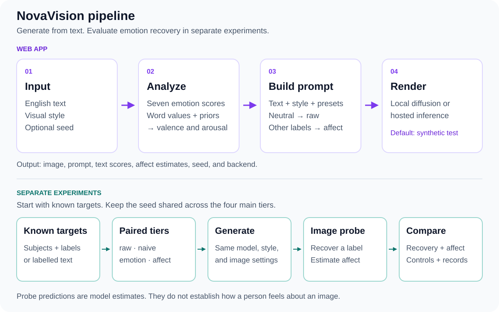

# Method

## Generation

| Stage | What it does | Tools |
|---|---|---|
| Analyze text | Score anger, disgust, fear, joy, neutral, sadness, and surprise | DistilRoBERTa, Transformers |
| Estimate affect | Blend lexicon values with priors for the leading emotion | Python, bundled word lexicon |
| Build prompt | Add mood, palette, lighting, and style terms | Prompt templates |
| Generate image | Render locally, through hosted inference, or as a synthetic test image | PyTorch, Diffusers, Hugging Face, NumPy, Pillow |

Classifier scores describe the text; they do not verify the writer's feelings.
Valence ranges from -1 to 1 and arousal from 0 to 1. Lexical coverage controls the
blend weight, capped at 80% by default. The bundled lexicon contains demonstration
values, not empirical norms. The app uses `affect` for non-neutral predictions and
`raw` for neutral predictions.

## Conditioning tiers

| Tier | Prompt content | Role |
|---|---|---|
| `raw` | Input text and style | Negative control |
| `naive` | Input text, bare emotion label, and style | Minimal emotion baseline |
| `emotion` | Input text, mood cues, and style | Mood conditioning |
| `affect` | Input text, mood, palette, lighting, and style | Affect conditioning |
| `scene` | A fixed scene for each emotion and style | Separate scene control |

Seeds are shared across tiers for paired comparisons. Prompt presets are part of
the evaluation conditions. Changing their wording creates a different experiment.

## Evaluation

The experiment runner evaluates generated images with a CLIP probe or a supplied
image classifier. It records recovery accuracy, macro-F1, confusion counts,
valence/arousal statistics, image–text alignment, controls, and provenance.
The web app displays text analysis and the generation prompt. Image recovery runs
in experiments.

| Track | Inputs | Affect targets | Control |
|---|---|---|---|
| Content | 20 hand-authored neutral subjects | Emotion priors | Raw and scene |
| Text | AffectBench sentences and gold emotion labels | Text-based lexicon/prior blend | Shuffled conditioning labels |

The content track tests palette and lighting cues tied to emotion priors. It does
not isolate variation in affect within one emotion. The text track supports that
comparison, but no text-track results are included in the saved pilot.

## Data

AffectBench is built on demand from single-label GoEmotions examples mapped to
seven classes. By default, the builder samples the pinned test split, removes
normalized duplicates and text shared with the train split, and records class
shortages and a file hash. This filtering does not establish what other models
saw during training. The 56 synthetic sentences in `tests/fixtures/` are test data.

Model and dataset terms apply separately from the project's MIT license. Hosted
inference sends the generation prompt to its provider. Obtain consent for human
ratings and keep sensitive text out of hosted requests.

## References

- Radford et al. (2021). [CLIP](https://proceedings.mlr.press/v139/radford21a.html).
- Sauer et al. (2023). [Adversarial Diffusion Distillation](https://arxiv.org/abs/2311.17042).
- Demszky et al. (2020). [GoEmotions](https://aclanthology.org/2020.acl-main.372/).
- Yang et al. (2023). [EmoSet](https://arxiv.org/abs/2307.07961).
